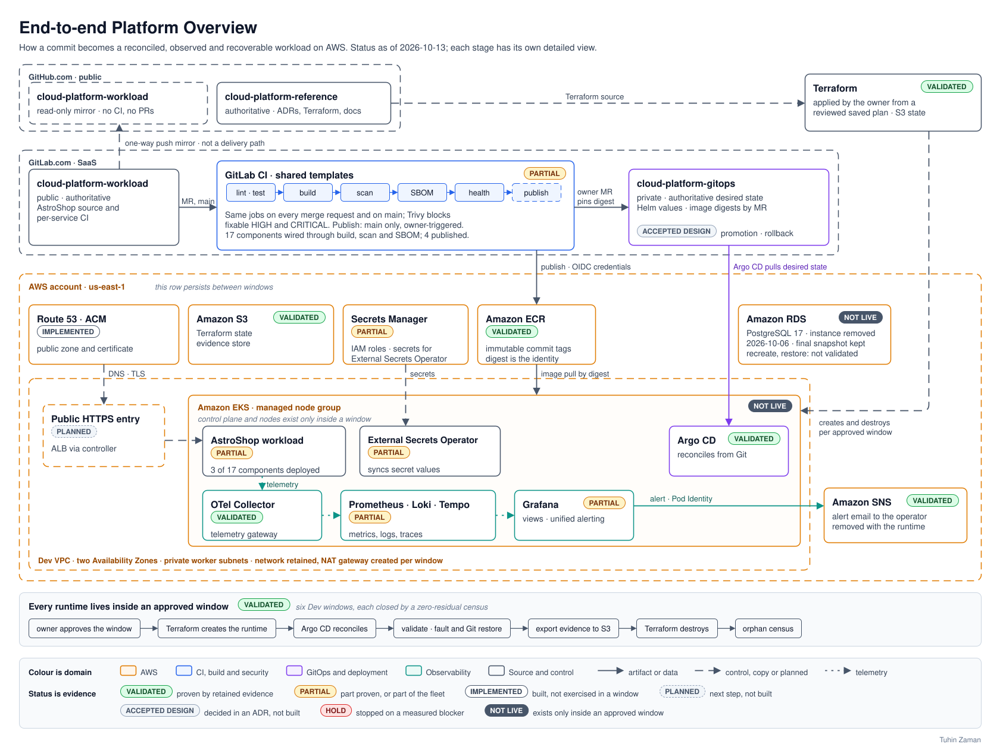

# Cloud Platform Reference

A production-inspired cloud platform on AWS, designed from first principles and implemented step
by step with evidence. Terraform provisions the AWS foundations and an Amazon EKS runtime, GitLab
CI builds, scans and publishes immutable container images to Amazon ECR, Argo CD deploys them by
digest from Git, and an OpenTelemetry-based stack observes the workload and delivers alerts. Every
runtime is created for a bounded, approved window, exercised, evidenced and destroyed.

The platform is the product. Its workload, AstroShop, is derived from the OpenTelemetry Demo and
exists to validate the platform.

## Current Status

Status as of 2026-10-16. Nothing in this repository is a production-readiness claim.

- **No runtime is running.** The Dev runtime (EKS control plane, managed node group and NAT
  gateway) exists only inside an approved window. Between windows only the persistent foundations,
  the retained Dev baseline, and the datastore's network boundary, credential containers and final
  snapshot remain.
- **Validated on AWS in six Dev windows, 2026-08-14 to 2026-09-13.** Each window created the
  runtime from Terraform and destroyed it with a zero-residual census; one was aborted at its first
  gate on a measured defect. Argo CD reconciled a three-service workload slice and its
  observability stack from Git, the running shipping image matched its published digest on four
  independent signals, an alert reached the operator, and an induced fault was restored through
  Git ([Runtime Validation](docs/validation/runtime-validation.md)).
- **Delivery coverage is partial.** All seventeen project-built components are wired through
  build, scan and SBOM in CI. Five have published images to Amazon ECR, and three of them,
  checkout, shipping and quote, ran in the validation windows. No image built from the container
  definitions hardened in October 2026 is recorded as published or run
  ([SERVICE-INVENTORY.md](https://gitlab.com/tuinzaman/cloud-platform-workload/-/blob/main/SERVICE-INVENTORY.md)).
- **Not yet proven:** the full fleet on EKS, which ADR-0017 makes the programme target; the public
  HTTPS entry and a real external request; rollback; promotion between environments; and the
  Validation and Production Validation environments, which have not been built.

## Architecture

Select the diagram for full size. Its status labels date from 2026-10-13; current results are in
[Runtime Validation](docs/validation/runtime-validation.md) and
[SERVICE-INVENTORY.md](https://gitlab.com/tuinzaman/cloud-platform-workload/-/blob/main/SERVICE-INVENTORY.md).

The decided platform is one AWS account in `us-east-1` with three environment roles, Dev,
Validation and Production Validation, each with its own VPC, EKS cluster, Terraform state and
telemetry; only Dev has been built. Nodes run in private subnets, and one managed HTTPS entry per
environment is decided but not yet built. Each application change becomes one image, promoted
through Git by its immutable digest rather than rebuilt. Recovery rebuilds from authoritative
sources, and backup covers only Terraform state, workload data, secret-store contents and exported
evidence.

Detailed views:

- Exported, like the overview, from [aws-platform-reference-architecture.drawio](docs/diagrams/aws-platform-reference-architecture.drawio): the [GitLab CI Pipeline](docs/diagrams/gitlab-ci-pipeline.svg) ([full size](docs/diagrams/gitlab-ci-pipeline.svg?raw=true)) and the [Repository Model](docs/diagrams/repository-model.md)
- Earlier renderings, not exported from that file: [Control, Delivery and GitOps](docs/diagrams/control-delivery-gitops.svg), [AWS Platform and Request Flow](docs/diagrams/aws-platform-request-flow.svg), and [Identity, Secrets, Observability, Evidence and Lifecycle](docs/diagrams/identity-observability-evidence-lifecycle.svg)

### Decisions

The twenty Accepted records in [docs/decisions](docs/decisions/) are the architecture authority,
and this summary changes none of them.

| Area | Records |
|---|---|
| Delivery method, cloud provider, Terraform and state, account and environments, identity | [ADR-0001](docs/decisions/0001-adopt-an-architecture-first-evidence-backed-delivery-method.md), [ADR-0002](docs/decisions/0002-select-aws-as-the-cloud-provider.md), [ADR-0003](docs/decisions/0003-adopt-terraform-and-remote-state-management.md), [ADR-0004](docs/decisions/0004-define-the-environment-and-account-topology.md), [ADR-0005](docs/decisions/0005-adopt-centralized-identity-and-least-privilege-access.md) |
| EKS runtime, networking and traffic, secrets and workload identity | [ADR-0006](docs/decisions/0006-adopt-amazon-eks-as-the-workload-runtime.md), [ADR-0007](docs/decisions/0007-define-networking-and-traffic-boundaries.md), [ADR-0008](docs/decisions/0008-define-the-secrets-and-workload-identity-model.md) |
| Software delivery, observability, backup and recovery | [ADR-0009](docs/decisions/0009-define-the-software-delivery-model.md), [ADR-0010](docs/decisions/0010-define-the-observability-model.md), [ADR-0011](docs/decisions/0011-define-the-backup-and-recovery-model.md) |
| Operations and cost | [ADR-0013](docs/decisions/0013-define-operations-and-cost-guardrails.md) |
| Reference workload and its implemented scope | [ADR-0012](docs/decisions/0012-formalize-the-reference-workload.md), [ADR-0014](docs/decisions/0014-expand-the-validated-implementation-workload-scope.md), [ADR-0016](docs/decisions/0016-bound-the-implemented-workload-scope-to-demonstrated-validation-value.md), [ADR-0017](docs/decisions/0017-adopt-a-full-fleet-end-to-end-platform-validation-program.md) |
| Security admission and image controls | [ADR-0015](docs/decisions/0015-define-security-admission-and-exception-governance-for-platform-managed-runtime-components.md), [ADR-0019](docs/decisions/0019-bound-immutable-image-controls-for-aws-managed-runtime-images.md), [ADR-0020](docs/decisions/0020-govern-the-ami-baked-kubernetes-sandbox-image.md) |
| Public entry, DNS and certificate | [ADR-0018](docs/decisions/0018-define-the-public-entry-implementation-dns-and-certificate-model.md) |

Accepted records are never edited; a later record narrows an earlier one and states exactly how
far it reaches. ADR-0013 replaces the continuously running Dev runtime that ADR-0004 assumes and
ADR-0006 and ADR-0007 restate. ADR-0014, ADR-0016 and ADR-0017 change the implemented workload
scope in turn. ADR-0019 narrows ADR-0017's pin-and-mirror requirement for AWS-managed add-on
images, and ADR-0020 narrows ADR-0017 and ADR-0019 for the sandbox image baked into the node AMI.

## Engineering Capabilities

**PROVEN** rests on retained runtime evidence, and **PARTIALLY PROVEN** names its boundary.
**IMPLEMENTED** means the code exists, and is applied where stated, with no runtime proof claimed.
**DESIGNED** means decided in an Accepted ADR and not built. Raw evidence stays private; the
linked pages are its sanitized summaries.

| Capability | What is built | Status | Evidence |
|---|---|---|---|
| Infrastructure as code | Four Terraform roots split by responsibility, S3 remote state, a reviewed plan before every apply | IMPLEMENTED; each applied root read back from AWS | [Root READMEs](terraform/) |
| Runtime lifecycle and teardown | The 17-resource Dev runtime, created for each window and removed by a targeted destroy and an orphan census by resource class | PROVEN in all six windows; evidence read back after destruction in the two most recent | [Windows](docs/validation/runtime-validation.md#windows) |
| Build and scan | Shared GitLab CI templates: image build, Trivy image and source-dependency gates that block fixable HIGH and CRITICAL findings, SBOM, container health check | Build, scan and SBOM IMPLEMENTED for 17 of 17 components; health checks vary by component | [trivy-scan.yml](https://gitlab.com/tuinzaman/cloud-platform-workload/-/blob/main/ci/templates/trivy-scan.yml), [SERVICE-INVENTORY.md](https://gitlab.com/tuinzaman/cloud-platform-workload/-/blob/main/SERVICE-INVENTORY.md) |
| Publication by digest | OIDC token exchange with no stored AWS credential, immutable ECR tags, a manual publish job on `main` | PROVEN for the checkout push path; 5 of 17 components published | [ecr-publish.yml](https://gitlab.com/tuinzaman/cloud-platform-workload/-/blob/main/ci/templates/ecr-publish.yml), [Foundation status](terraform/foundation/README.md#status) |
| GitOps delivery | Argo CD with three value layers, digest pins and manual sync | Reconciliation PROVEN; image identity PROVEN for shipping, PARTIALLY PROVEN for quote and checkout | [GitOps Delivery](docs/implementation/gitops-delivery.md), [Results](docs/validation/runtime-validation.md#what-has-been-demonstrated) |
| Workload identity and secrets | EKS Pod Identity, External Secrets Operator reading AWS Secrets Manager, IMDSv2 with a hop limit of 1 | PROVEN for the alerting publisher; secret synchronisation PARTIALLY PROVEN; an ordinary pod observed failing to obtain node credentials | [Dev identity](terraform/dev/README.md#identity-secrets-and-configuration), [Results](docs/validation/runtime-validation.md#what-has-been-demonstrated) |
| Telemetry | OpenTelemetry Collector gateway; Prometheus, Loki and Tempo; Grafana views; 2-hour retention | Kubernetes identity on metrics, logs and traces PROVEN; retention PROVEN as combined evidence; views PARTIALLY PROVEN | [Results](docs/validation/runtime-validation.md#what-has-been-demonstrated) |
| Alerting | Grafana alert rule to an Amazon SNS email, published under Pod Identity | Delivery PROVEN; a cardinality clause added later failed and is withdrawn | [Results](docs/validation/runtime-validation.md#what-has-been-demonstrated) |
| Recovery | Fault and restore merged as Git changes and proven by tree equality with the anchor; Terraform state restored from a prior object version | Git restore PROVEN, 7m41s after the fault ended against a 30-minute requirement; state recovery PROVEN on an isolated copy of the foundation state only | [Recovery pattern](docs/validation/runtime-validation.md#recovery-pattern), [State recovery](docs/runbooks/terraform-operations.md#not-yet-exercised) |
| Cost guardrails | Monthly budget with a 100 USD target, a 150 USD review threshold and a 200 USD ceiling; runtime only inside windows | IMPLEMENTED; budget read back, alert delivery untested | [ADR-0013](docs/decisions/0013-define-operations-and-cost-guardrails.md), [Budget check](docs/runbooks/cost-and-residue.md#budget-check) |
| Public entry | Route 53 zone and ACM certificate; an ALB through the AWS Load Balancer Controller | Zone and certificate IMPLEMENTED and read back; the entry DESIGNED, not built | [Foundation status](terraform/foundation/README.md#status), [ADR-0018](docs/decisions/0018-define-the-public-entry-implementation-dns-and-certificate-model.md) |
| Datastore | RDS PostgreSQL 17.11 with its network boundary and credential containers | IMPLEMENTED and read back, no workload connected; decommissioned 2026-10-06, final snapshot kept | [Datastore status](terraform/dev-datastore/README.md#status) |
| Security admission | ADR-0015 gate per component, digest and window, with exceptions that expire with their window | Exercised in the observability windows: five platform images ran under exceptions, now expired | [ADR-0015](docs/decisions/0015-define-security-admission-and-exception-governance-for-platform-managed-runtime-components.md), [Limitations](docs/validation/runtime-validation.md#declared-limitations) |

## Repository Structure and Ownership

The platform spans three repositories, each with one responsibility and one authoritative host
([ADR-0009](docs/decisions/0009-define-the-software-delivery-model.md)). This one is the place to
start.

| Repository | Authoritative host | Holds | Visibility |
|---|---|---|---|
| **cloud-platform-reference** (this repository) | GitHub | Architecture, decisions, Terraform, implementation, runbooks and validation summaries | Public |
| [**cloud-platform-workload**](https://gitlab.com/tuinzaman/cloud-platform-workload) | GitLab, where merge requests and CI run. The [GitHub copy](https://github.com/Tuhinzman/cloud-platform-workload) is a one-way mirror for browsing | AstroShop source, container definitions, and the CI that builds, scans and publishes images: [`.gitlab-ci.yml`](https://gitlab.com/tuinzaman/cloud-platform-workload/-/blob/main/.gitlab-ci.yml) and [shared templates](https://gitlab.com/tuinzaman/cloud-platform-workload/-/tree/main/ci/templates) | Public |
| **cloud-platform-gitops** | GitLab, not mirrored | The desired state Argo CD reconciles: value layers and the image digest each environment runs | Private, because its pins carry live registry coordinates. [GitOps Delivery](docs/implementation/gitops-delivery.md) documents the model |

Mirror updates can lag behind GitLab; [Repository Model](docs/diagrams/repository-model.md) draws
the hosting model. The platform, meaning the Terraform, the CI templates, the GitOps desired state
and the validation harness, is original to this project. AstroShop is a derivation of the
OpenTelemetry Demo; what was taken, changed and excluded is recorded in the workload repository's
[DERIVATION.md](https://gitlab.com/tuinzaman/cloud-platform-workload/-/blob/main/DERIVATION.md).

| Path | Contents |
|---|---|
| [docs/](docs/) | The foundation documents: [Project Charter](docs/project-charter.md), [Platform Capability Model](docs/capability-model.md), [Requirements Baseline](docs/requirements-baseline.md), [System Context](docs/system-context.md), [Logical Architecture](docs/logical-architecture.md), [Architecture Baseline](docs/architecture-baseline.md) |
| [docs/decisions/](docs/decisions/) | Accepted architecture decision records |
| [docs/diagrams/](docs/diagrams/) | Architecture views and their draw.io source |
| [docs/implementation/](docs/implementation/) | How a source change becomes a running container |
| [docs/runbooks/](docs/runbooks/) | Operating procedures, validation labels and known gaps |
| [docs/validation/](docs/validation/) | The sanitized runtime validation summary |
| [terraform/](terraform/) | One root per responsibility: bootstrap, foundation, dev and dev-datastore |

## Reproducing the Platform

You need one dedicated AWS account, Terraform and an operator identity as described in
[operator access](docs/runbooks/operator-access.md). Each root reads its private inputs from an
untracked `terraform.tfvars`; the tracked `terraform.tfvars.example` beside it lists what must be
supplied, and nothing requires the owner's account identifier, addresses, state or evidence. To
check the code without AWS, follow
[Validate locally, without AWS](docs/runbooks/README.md#validate-locally-without-aws). Apply the
roots in order, each from its own directory with a reviewed plan; the runbook
[build order](docs/runbooks/README.md#build-order) is the procedure for steps 1 to 4.

1. [terraform/bootstrap](terraform/bootstrap/README.md): the remote-state backend. Applied once with local state, then migrated.
2. [terraform/foundation](terraform/foundation/README.md): resources that outlive every environment, meaning the evidence store, the container registry, the CI push identity, and the public DNS zone with its certificate, applied in two steps around the registrar delegation.
3. [terraform/dev](terraform/dev/README.md): the Dev environment, split into a retained baseline and a runtime created for each approved window and destroyed at its close.
4. [terraform/dev-datastore](terraform/dev-datastore/README.md): the Dev datastore, a PostgreSQL instance with its network boundary and credential containers, kept outside every runtime window's teardown. The instance was decommissioned on 2026-10-06 and its final snapshot kept.
5. Cluster bootstrap and GitOps: Argo CD reconciles the private desired-state repository against the running cluster; the bootstrap order, the value layering and the digest pin are in [GitOps Delivery](docs/implementation/gitops-delivery.md), and the decision behind them in [ADR-0009](docs/decisions/0009-define-the-software-delivery-model.md).
6. The workload is built and published by the [workload repository's pipelines](https://gitlab.com/tuinzaman/cloud-platform-workload) and deployed by digest through step 5.

> **Warning:** Do not run a plain `terraform apply` in `terraform/dev`: it creates the billable
> runtime; its first build is targeted.

Some steps stay manual by design, as owner or operator boundaries rather than gaps in automation:
the Identity Center and account prerequisites, the budget and its alerts, the registrar
name-server change, placing secret values out of band, the explicit authorization and execution
of every infrastructure apply, and the merges the protected branches require.

Current gaps:

- The build order has not been run end to end from a fresh clone of the current configuration,
  and with every item supplied it ends at a built datastore, not a running cluster.
- Steps 5 and 6 are outside the runbooks. What they need that is not published, such as the
  runtime window that creates the cluster and the mirroring of platform images into the registry,
  is under [Known reproducibility gaps](docs/runbooks/README.md#known-reproducibility-gaps).
- Some tools are not published, such as those the datastore's secret placement requires;
  [What these runbooks are](docs/runbooks/README.md#scope) lists what you supply yourself.
- The validation windows ran an earlier revision of `terraform/dev`, and its current worker-mode
  definition has not been applied
  ([Lifecycle and current state](terraform/dev/README.md#lifecycle-and-current-state)).

## Known Limitations

- **Scope.** Results cover Dev, the three-service slice and the named windows only. The three
  fleet-scale properties ADR-0016 names stay declared limitations until the full fleet runs, a
  condition ADR-0017 leaves in force.
- **Security exceptions.** The observability and alert-delivery results were observed while five
  platform-managed images, Prometheus, kube-state-metrics, Grafana, Loki and Tempo, ran under
  bounded, per-digest ADR-0015 exceptions approved only for those windows and expired with them,
  so they are reported as observed under exception, not as clean, vulnerability-free or
  security-gate-passed.
- **Point-in-time scans.** Each published digest carries the scan result of its own build. The
  checkout artifact deployed in the windows had no fixable HIGH or CRITICAL finding at its
  2026-08-15 publication scan; a HIGH gRPC finding, CVE-2026-84445, was later fixed in source with
  grpc v1.83.2, and that artifact has not been rebuilt or rescanned.
- **SBOM and provenance.** The SBOM comes from the image, so for a statically linked or single-file
  service it describes the base image, not the application's dependencies. Pipeline-retained
  provenance exists only for publications that have not run in a window, and frontend-proxy's
  bundle failed verification; the shipping digest that ran had its scan and SBOM recovered by hand.
- **Observability.** The trace-store selection ADR-0010 defers is open, trace-to-logs traversal in
  the operational view is NOT PROVEN, telemetry enrichment is uneven across services, and object
  deletion under retention was not observed on EKS. One continuous fault produced six alert
  notifications in about nineteen minutes, for a reason not isolated
  ([declared limitations](docs/validation/runtime-validation.md#declared-limitations)).
- **Identity and network.** The synchronised secret read is not attributed to the controller's own
  role, the workload IAM role has not been used by any pod, and NetworkPolicy enforcement is
  untested. A deactivated legacy IAM access key still exists, and the identity configuration still
  deviates from the ADR-0005 target model
  ([operator access](docs/runbooks/operator-access.md#not-yet-exercised)).
- **GitOps.** The automatic CI-to-GitOps Dev pin ADR-0009 describes is not implemented, so every
  pin so far is a manual reviewed change; sync is manual, and the `default` AppProject is a
  declared limitation.
- **Recovery.** ADR-0011 is incomplete: workload-data restore, secret deletion recovery, datastore
  recreation and snapshot restore are unexercised
  ([recovery obligations](docs/runbooks/README.md#recovery-obligations)). One induced memory fault
  did not produce its intended effect and is INDETERMINATE.
- **Cost.** Window costs are rate-derived upper bounds, not billing statements, and AWS Budgets
  notify rather than prevent spend.

## License

Apache License 2.0. See [LICENSE](LICENSE).
