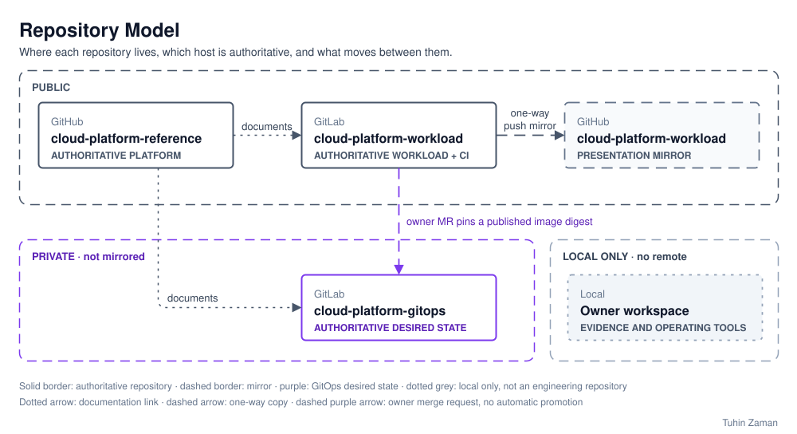

# Repository Model

Three engineering repositories carry the platform, each with one responsibility and one
authoritative host ([ADR-0009](../decisions/0009-define-the-software-delivery-model.md)). The
owner workspace is drawn apart from them: it is local only and is not an engineering repository.

[Open full-size diagram](repository-model.svg?raw=true)

- **cloud-platform-reference** (GitHub): architecture, decisions, Terraform and documentation.
  Start here. It documents the workload repository and the model the GitOps repository
  implements, and links to both.
- **cloud-platform-workload** (GitLab): the workload source, container builds and per-service CI.
  Merge requests, pipelines and history stay on GitLab.
- **The GitHub copy of cloud-platform-workload** is a one-way presentation mirror that GitLab
  pushes to, with GitHub Actions disabled. Not developing in the mirror is an owner working rule,
  not an enforced permission boundary. Mirror updates can lag behind GitLab, and a branch deleted
  on GitLab can remain on GitHub.
- **cloud-platform-gitops** (GitLab, private): the desired state Argo CD reconciles, with its
  values and the image digest each environment runs. A published image digest is pinned there by
  an owner merge request; no CI job promotes it. It is not mirrored.
- **The owner workspace** holds raw evidence and operator tooling. It has no remote and is never
  published.

Dotted arrows are documentation links, the dashed arrow is the one-way push mirror, and the dashed
purple arrow is the owner merge request that pins a published image digest. The diagram is the
Repository Model page of
[aws-platform-reference-architecture.drawio](aws-platform-reference-architecture.drawio),
exported to SVG.
