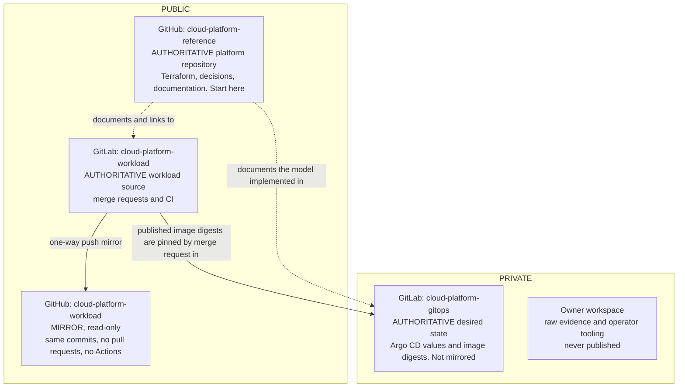

# Repository Model

Three repositories carry the platform, each with one responsibility and one authoritative
host ([ADR-0009](../decisions/0009-define-the-software-delivery-model.md)). The GitHub copy of
the workload repository is a one-way mirror kept for browsing: merge requests, pipelines and
the authoritative history stay on GitLab, and nothing is developed in the mirror.

Solid arrows carry Git objects or artifact identity in one direction. Dotted arrows are
documentation links. The mirror is never ahead of GitLab and shows nothing that has not been
pushed there.
