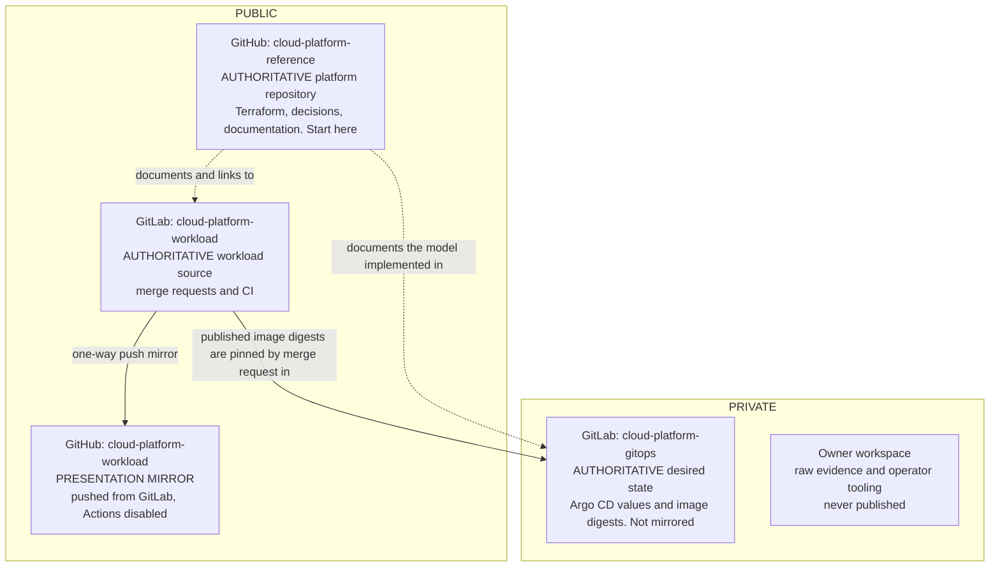

# Repository Model

Three repositories carry the platform, each with one responsibility and one authoritative
host ([ADR-0009](../decisions/0009-define-the-software-delivery-model.md)). GitLab holds the
authoritative workload repository, and merge requests, pipelines and history stay there. The
GitHub copy is a one-way presentation mirror that GitLab pushes to, with GitHub Actions
disabled. Not developing in the mirror is an owner working rule, not an enforced permission
boundary.

Solid arrows carry Git objects or artifact identity in one direction. Dotted arrows are
documentation links. Mirror updates can lag behind GitLab, and a branch deleted on GitLab can
remain on GitHub.
